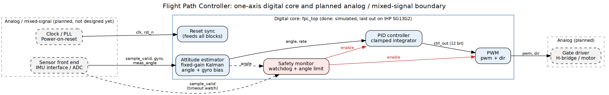
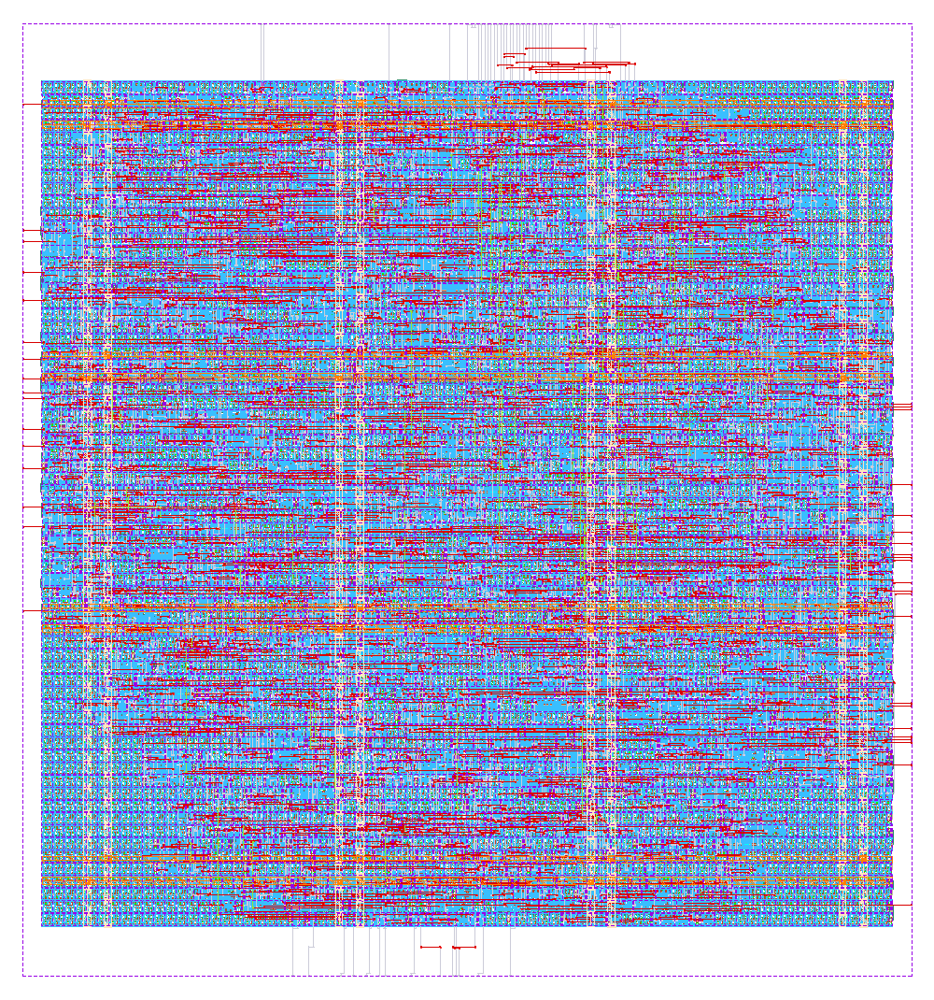

# Flight Path Controller: digital core (front-end prototype)

A small, tool-neutral RTL prototype of a one-axis flight path controller, built as a stepping stone for
VIT's Indigenous Flight Path Controller Chip effort. The digital part is complete enough to simulate end to
end; the analog / mixed-signal parts are only specified as interfaces (see `docs/AMS_IDEAS.md`).

```
 [sensor front end]  sample_valid, gyro, meas_angle        [actuator]
  (analog / mixed     ───────────────▶  attitude estimator ─▶ PID ─▶ PWM ───▶ pwm, dir
   signal, later)                                  ▲                 │
                                        safety monitor (watchdog + angle limit)
```



| Block | File | What it does |
|---|---|---|
| Attitude estimator | `rtl/fpc_attitude_est.v` | Fixed-gain Kalman filter: fuses gyro rate and an angle measurement, estimates gyro bias |
| PID | `rtl/fpc_pid.v` | Derivative on measurement, clamped integrator, saturated 12-bit output |
| PWM | `rtl/fpc_pwm.v` | Signed-magnitude PWM (H-bridge style `pwm` + `dir`) |
| Safety monitor | `rtl/fpc_safety.v` | Latches a fault on sensor timeout or over-angle and forces the outputs off |
| Reset sync | `rtl/fpc_rst_sync.v` | Async assert, sync release |
| Top | `rtl/fpc_top.v` | Wires it together; the BOUNDARY ports are the contract for the analog blocks |

## Run it
Needs `iverilog`, `verilator`, `yosys` (all in OSS CAD Suite).
```
make lint     # Verilator lint
make sim      # closed-loop self-checking testbench, writes build/fpc.vcd
make synth    # generic-gate Yosys synthesis, writes build/synth_stat.txt
```
The testbench closes the loop around a behavioural plant (damped rotating body, biased and noisy gyro) and checks:
recovery from a 0.3 rad offset, rejection of a constant disturbance torque, watchdog trip on sensor loss,
over-angle trip, and fault clearing. Expected last line: `TB_RESULT: PASS`.

## Physical design (IHP SG13G2, open PDK)
```
flow/ihp_sg13g2/run.sh        # needs Docker; PDK fetch command is in the script header
```


## Status
- Done and passing here: lint, simulation (10 checks), generic synthesis, and a full RTL-to-GDS run on the open
  IHP SG13G2 PDK: DRC-clean, LVS-clean, timing met at 50 MHz (details in `flow/ihp_sg13g2/RESULTS.md`).
- Not done: pad ring and tape-out sign-off, any Synopsys tool run (scripts are templates, see
  `docs/SYNOPSYS_MIGRATION.md`), FPGA bring-up, real sensor models.
- Known simplifications are marked `shortcut:` in the RTL.

## Docs
`docs/ARCHITECTURE.md` (formats, timing, design choices), `docs/AMS_IDEAS.md` (analog/mixed-signal plan),
`docs/SYNOPSYS_MIGRATION.md` (how each step maps to Synopsys tools).
